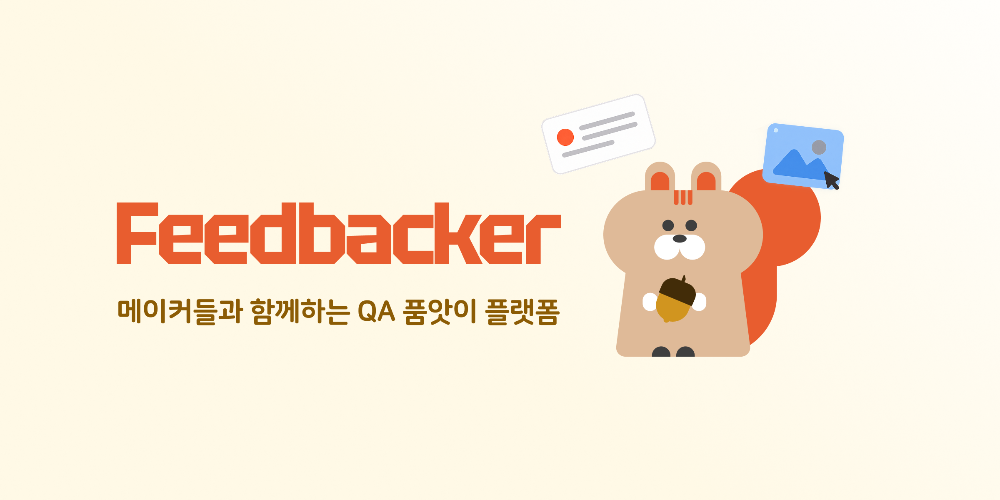
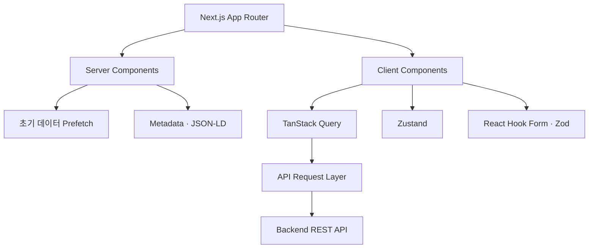
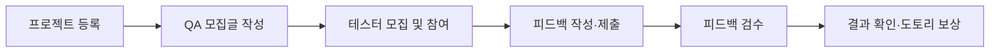

# Feedbacker

메이커들이 서로의 서비스를 테스트하고 피드백을 주고받는 **QA 품앗이 플랫폼**입니다.

프로젝트를 등록해 QA 참여자를 모집하거나, 다른 메이커의 서비스 테스트에 참여해 피드백과 도토리 보상을 주고받을 수 있습니다.

**팀 프로젝트 · Frontend Repository**

[서비스 바로가기](https://feedbacker.co.kr)



## 기술 스택

- **Frontend:** Next.js 16, React 19, TypeScript
- **State Management:** TanStack Query, Zustand
- **Form & Validation:** React Hook Form, Zod
- **Styling:** Tailwind CSS, Base UI
- **Interaction:** DnD Kit, Embla Carousel
- **API:** REST API
- **Analytics:** Google Analytics 4

## 디렉터리 구조

```text
src/
├── app/          # App Router 페이지와 레이아웃
├── components/   # 공통·도메인·레이아웃 컴포넌트
├── apis/         # REST API 요청 함수
├── hooks/        # 데이터 요청과 도메인 훅
├── lib/          # 인증·폼·SEO·공통 로직
├── stores/       # Zustand 전역 상태
├── types/        # API 및 도메인 타입
└── constants/    # 서비스 공통 상수
```

## 애플리케이션 구조



- App Router 기반으로 공개 페이지와 인증이 필요한 페이지를 분리합니다.
- 서버에서 초기 목록 데이터를 조회하고 클라이언트 캐시로 전달합니다.
- 서버 데이터는 TanStack Query, 인증과 전역 UI 상태는 Zustand로 관리합니다.
- API 요청 함수와 응답 타입을 도메인별로 분리합니다.
- React Hook Form과 Zod를 활용해 동적 폼 상태와 입력값을 검증합니다.

## 주요 기능

### 프로젝트 등록 및 탐색

- 프로젝트 등록·수정·삭제
- 썸네일, 서비스 링크, 태그 및 Markdown 설명 작성
- 키워드·태그 기반 검색과 최신순·조회순 정렬
- 작성 중인 프로젝트 정보 임시 저장

### QA 모집

- 등록한 프로젝트를 기반으로 QA 모집글 작성
- 서비스 링크형·이미지형 테스트 지원
- 단일 선택·복수 선택·주관식 질문 구성
- 질문 순서 변경과 이미지 첨부
- 모집 인원·마감일·도토리 보상 설정

### QA 참여 및 피드백

- 모집 중인 QA 검색 및 참여
- 질문 유형에 따른 동적 피드백 폼 제공
- 주관식 답변과 이미지 첨부
- 작성 중인 답변 임시 저장 및 복원
- 피드백 제출 또는 참여 포기

### 피드백 검수 및 결과 확인

- 제출된 피드백 조회
- 피드백 수락·거절 및 거절 사유 관리
- 거절 결과에 대한 참여자 이의제기
- 객관식 응답 통계와 주관식 답변 조회
- 참여자별 피드백 결과 확인

### 마이페이지 및 보상

- 등록 프로젝트와 QA 모집·참여 내역 관리
- 진행 중인 QA의 모집·제출·검수 현황 확인
- 도토리 적립·사용 내역 조회
- 프로필 수정 및 회원 탈퇴
- 활동 상태에 따른 성장 정보 제공

## 사용자 흐름



## 인증

- 이메일 회원가입·로그인 및 이메일 인증
- 카카오 OAuth 로그인
- 액세스 토큰 기반 인증 요청
- 세션 갱신과 로그아웃
- 프로필 미완성 사용자의 접근 제어

## UI/UX 및 SEO

- 공통 컴포넌트를 기반으로 폼·다이얼로그·알림 UI 구성
- 작성 중인 프로젝트와 피드백의 자동 임시 저장
- 로딩·빈 화면·오류·재시도 상태 제공
- Server Components 기반 초기 데이터 조회
- canonical·Open Graph·Twitter 메타데이터 구성
- JSON-LD 구조화 데이터와 동적 sitemap 적용
- 검색 노출이 필요하지 않은 페이지의 색인 제어

## 로컬 실행

### 1. 패키지 설치

```bash
pnpm install
```

### 2. 환경변수 설정

프로젝트 루트에 `.env.local` 파일을 생성합니다.

```env
NEXT_PUBLIC_API_URL=
NEXT_PUBLIC_KAKAO_REST_API_KEY=
NEXT_PUBLIC_GOOGLE_ANALYTICS_ID=
```

`NEXT_PUBLIC_GOOGLE_ANALYTICS_ID`는 분석 기능을 사용하지 않는 로컬 환경에서는 생략할 수 있습니다.

환경변수 값과 인증 정보는 저장소에 포함하지 않습니다.

### 3. 개발 서버 실행

```bash
pnpm dev
```

브라우저에서 [http://localhost:3000](http://localhost:3000)에 접속합니다.
